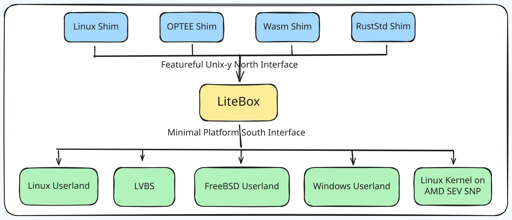

# LiteBox

> A security-focused library OS

> [!NOTE]  
> This project is currently actively evolving and improving. While we are
> working toward a stable release, some APIs and interfaces may change as the
> design continues to mature. You are welcome to explore and experiment, but if
> you need long-term stability, it may be best to wait for a stable release, or
> be prepared to adapt to updates along the way.

LiteBox is a sandboxing library OS that drastically cuts down the interface to the host, thereby reducing attack surface.  It focuses on easy interop of various "North" shims and "South" platforms.  LiteBox is designed for usage in both kernel and non-kernel scenarios.

LiteBox exposes a Rust-y [`nix`](https://docs.rs/nix)/[`rustix`](https://docs.rs/rustix)-inspired "North" interface when it is provided a `Platform` interface at its "South".  These interfaces allow for a wide variety of use-cases, easily allowing for connection between any of the North--South pairs.

Example use cases include:
- Running unmodified Linux programs on Windows
- Sandboxing Linux applications on Linux
- Run programs on top of SEV SNP
- Running OP-TEE programs on Linux
- Running on LVBS

### IPv4 ping with the userland broker

Guests can use IPv4 datagram ping sockets (`SOCK_DGRAM`, `IPPROTO_ICMP`) to
send echo requests within the guest network, for example `ping -4 -c 1 127.0.0.1`.
To permit an external destination, pass
`--allow-icmp-echo-destination 192.0.2.17/32` to the broker, substituting the
target's IPv4 address. Repeat the flag for additional networks, or, with the
containerd shim, set `io.litebox.egress.icmp-echo` to a comma-separated list
of canonical IPv4 CIDRs. The host gateway (`10.0.2.1`) also requires an explicit
rule. These rules have no port range and do not grant UDP or raw socket access.
External echo requires a Linux host that permits the broker's group to create
ping sockets (`net.ipv4.ping_group_range`); guest loopback needs no host ping socket.
If `iputils` ping tries to discover its source with an external UDP connection,
use `ping -4 -I 10.0.2.15 -c 1 TARGET` to select the guest address explicitly.

## Contributing

See the following files for details:

- [CONTRIBUTING.md](./CONTRIBUTING.md)
- [CODE_OF_CONDUCT.md](./CODE_OF_CONDUCT.md)
- [SECURITY.md](./SECURITY.md)
- [SUPPORT.md](./SUPPORT.md)

## License

MIT License.  See [./LICENSE](./LICENSE) for details.

## Trademarks

This project may contain trademarks or logos for projects, products, or services. Authorized use of Microsoft 
trademarks or logos is subject to and must follow 
[Microsoft's Trademark & Brand Guidelines](https://www.microsoft.com/en-us/legal/intellectualproperty/trademarks/usage/general).
Use of Microsoft trademarks or logos in modified versions of this project must not cause confusion or imply Microsoft sponsorship.
Any use of third-party trademarks or logos are subject to those third-party's policies.
