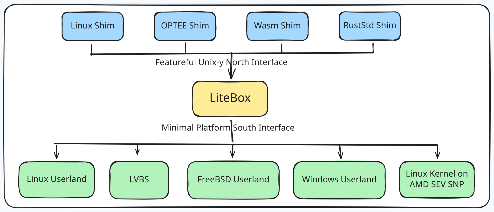

# LiteBox

> A security-focused library OS

> [!NOTE]  
> This project is currently actively evolving and improving. While we are
> working toward a stable release, some APIs and interfaces may change as the
> design continues to mature. You are welcome to explore and experiment, but if
> you need long-term stability, it may be best to wait for a stable release, or
> be prepared to adapt to updates along the way.

LiteBox is a sandboxing library OS that drastically cuts down the interface to the host, thereby reducing attack surface.  It focuses on easy interop of various "North" shims and "South" platforms.  LiteBox is designed for usage in both kernel and non-kernel scenarios.

LiteBox exposes a Rust-y [`nix`](https://docs.rs/nix)/[`rustix`](https://docs.rs/rustix)-inspired "North" interface when it is provided a `Platform` interface at its "South".  These interfaces allow for a wide variety of use-cases, easily allowing for connection between any of the North--South pairs.

Example use cases include:
- Running unmodified Linux programs on Windows
- Sandboxing Linux applications on Linux
- Run programs on top of SEV SNP
- Running OP-TEE programs on Linux
- Running on LVBS

## Linux userland terminals

The userland broker supports inherited Linux terminals with a shared,
guest-ABI-independent line discipline in `litebox_broker_core::terminal`.
Platform adapters supply raw transport, readiness, and geometry; the Linux
shim translates termios and terminal ioctls and maps typed terminal events to
guest signals. Terminal settings and input queues are shared across reopened,
duplicated, forked, and exec-inherited descriptors. Redirected streams remain
ordinary byte streams.

The initial implementation supports canonical editing and EOF, raw input,
echo, software flow control, output processing, drain/flush, and window-size
queries and updates. Interrupt, quit, and resize events target the process
group initially attached to the endpoint. Host attributes are restored on
normal broker teardown. Input and output queues are bounded. Raw input is
backpressured; control-enabled input and echo can overrun with a warning,
without preventing interrupt or flow-control characters from being processed.

This is not complete POSIX job control: controlling-terminal acquisition,
foreground-group changes, suspend/continue, and guest PTYs are not implemented.
Timed reads, `VMIN > 1`, unsupported termios flags/editing characters, and serial
configuration are rejected rather than silently accepted. Noncanonical reads
support `VMIN` zero or one with `VTIME` zero. Other platform adapters do not yet
expose terminal controls.

## Contributing

See the following files for details:

- [CONTRIBUTING.md](./CONTRIBUTING.md)
- [CODE_OF_CONDUCT.md](./CODE_OF_CONDUCT.md)
- [SECURITY.md](./SECURITY.md)
- [SUPPORT.md](./SUPPORT.md)

## License

MIT License.  See [./LICENSE](./LICENSE) for details.

## Trademarks

This project may contain trademarks or logos for projects, products, or services. Authorized use of Microsoft 
trademarks or logos is subject to and must follow 
[Microsoft's Trademark & Brand Guidelines](https://www.microsoft.com/en-us/legal/intellectualproperty/trademarks/usage/general).
Use of Microsoft trademarks or logos in modified versions of this project must not cause confusion or imply Microsoft sponsorship.
Any use of third-party trademarks or logos are subject to those third-party's policies.
