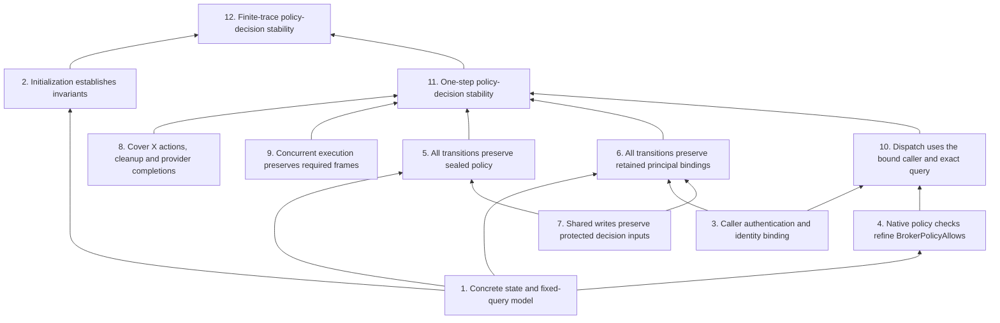

# Verification and the trust boundary

The broker is **not fully verified**. A successful `vlitebox` check alone does
not check imported executable bodies. Verify the original platform, protocol and
core crates independently as well as this composition crate.

## Source layout

| Location | Role |
| --- | --- |
| `vlitebox/src/spec/` | Property definitions and interfaces to native contracts; not assumed executable guarantees |
| `vlitebox/src/properties/` | Checked proofs and actual-call compositions |
| Native `*_spec.rs` and executable annotations | Intended outcomes, contracts and their checked native-body relationships |
| `vlitebox-thirdparty/src/assumptions/` | Local **unproved behavioral contracts**, currently `core::mem::take` |
| `vlitebox-thirdparty/src/opaque/`, native `*_opaque.rs` | Opaque type registrations; implementations remain unverified |
| Native `external_body` / `external_derive` annotations | Explicit body/derive exclusions, kept beside the affected declarations |
| `vlitebox/src/test-negative/` | Expected postcondition failures, not correctness proofs |

For example, `file_offset_outcome` defines the intended result. The contract on
the original `checked_offset` body is checked against that definition. Neither
the definition nor an empty theorem packaging the contract is an assumed
implementation guarantee. The property definition must still be reviewed to
ensure it expresses the requirement we actually want.

Opaque registration does **not** justify assuming the behavior of a lock,
reference count, resource identity or access-right operation. Those remain gaps.
The `mem::take` declaration is different: its postconditions are accepted without
checking the standard-library body. Waiter extraction is conditional on it.

## Reproducible inventory

From the repository root, using Python 3.11 or newer:

```sh
python3 dev_tools/verus_trust/inventory.py --check-layout
python3 dev_tools/verus_trust/inventory.py --json
python3 -m unittest discover -s dev_tools/verus_trust -p 'test_*.py'
```

The report lists each explicit trust construct with its source location and
source text. Behavioral assumption declarations include their complete
signature/postconditions through the terminating semicolon. For exclusions and
opaque registrations, **only the attribute block** is counted, not a purported
count of all trusted contracts in that item. Counts are unique physical source
lines per category, including intervening blank/comment lines; categories can
overlap and must not be added into a "trusted LOC" total.

The scan covers Rust sources in the five named broker-verification packages,
including inactive cfg branches. It does not expand macros, identify reachable
unannotated bodies, establish which generated derives the frontend ignores, or
prove that any body has been selected and checked. Source hashes identify the
audited snapshot. Layout checks reject explicit trust syntax in `spec/` and
`properties/`, behavioral assumptions outside `assumptions/`, and opaque
registrations outside designated opaque source.

### Imported SDK trust is separate

Local counts **exclude** Verus/vstd contracts and axioms. The inventory reports
the manifest's SDK dependency declarations, not a claim that those are the
installed binaries. To inventory an already installed vstd source snapshot:

```sh
python3 dev_tools/verus_trust/inventory.py --json --sdk-source /path/to/vstd
```

That optional section counts SDK source syntax separately; it is not the set of
contracts actually used by these proofs, a dependency-closure analysis, or proof
that SDK implementations were checked. Existing SDK vector/allocation,
iterator/`try_fold`, Option, NonZero and other contracts can remain trusted even
when the local behavioral-assumption count is one. The verifier, compiler,
solver and correctness of the specifications are also outside this line count.

The inventory is an audit aid, **not a no-cheating check or coverage certificate**.
Continue to run fresh selected-crate verification with `--no-cheating`, inspect
actual implementation selection when needed, and retain known failures rather
than treating missing annotations as verified code.

## Top-level proof roadmap

The cross-runner target in [`docs/spec.md` sections 5.4 and 8](../docs/spec.md)
preserves `BrokerPolicyAllows` for the same retained runner, canonical resource
or scope, and complete operation after X-attributable steps. It does not claim
equal syscall results or equal full `Grant` predicates. Shared filesystem
metadata, quota availability and lifecycle can legitimately affect those.

The proposed decomposition has **12 proof obligations: 10 prerequisites and
2 composition proofs**. These are proof families, not equally sized tasks or an
exhaustive count of implementation lemmas. None is fully discharged against the
implementation today; existing native leaf proofs provide partial support only.



In particular, obligation 8 must connect the transition model to actual hostile
inputs and implementation paths, not assume all requests are well formed.
Obligation 9 must establish the frames under actual synchronization, not assume
an entire syscall is atomic. An initial one-request-kind theorem would cover
only that slice; extending it requires covering the other transition families.

This diagram concerns broker-policy stability, under explicitly stated external
boundary contracts. Whole-sandbox confinement additionally requires faithful
effect enforcement, native-operation confinement and bootstrap/deployment
proofs (specification section 8, obligations A-C).
